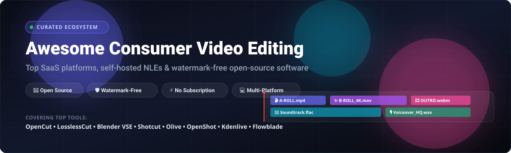

# 🎬 Awesome Consumer Video Editing Software

  

  
  
  
  
  
  
  

---

## 🌟 Top Consumer Video Editing Software Ecosystem

> **A curated showcase of premier consumer video editing software, creator-friendly SaaS platforms, and free, watermark-free open-source video editors.**

*Designed for content creators, vloggers, YouTubers, educators, and hobbyists seeking accessible desktop video editors, one-time purchase suites, or zero-cost, self-hosted Non-Linear Editors (NLEs).*

**📅 Last updated: October 2026**

---

## 📑 Table of Contents

- [🔍 Sector Overview & Market Dynamics](#-sector-overview--market-dynamics)
- [💻 SaaS & Commercial Platforms](#-saas--commercial-platforms)
- [🚀 Open-Source GitHub Projects](#-open-source-github-projects)
  - [1. OpenCut](#1-opencut-)
  - [2. LosslessCut](#2-losslesscut-)
  - [3. Blender (Video Sequence Editor)](#3-blender-video-sequence-editor-)
  - [4. Shotcut](#4-shotcut-)
  - [5. Olive Video Editor](#5-olive-video-editor-)
  - [6. OpenShot](#6-openshot-)
  - [7. Kdenlive](#7-kdenlive-)
  - [8. Flowblade](#8-flowblade-)
  - [9. Pitivi](#9-pitivi-)
  - [Special Mention: DaVinci Resolve (Free Tier)](#special-mention-davinci-resolve-free-tier)
- [🤝 How to Contribute](#-how-to-contribute)
- [💖 Support & Sponsorship](#-support--sponsorship)
- [📊 Star History](#-star-history)
- [⚖️ Disclaimer](#-disclaimer)

---

## 🔍 Sector Overview & Market Dynamics

The global video editing software market is estimated at approximately **$1.1 billion to $3.2 billion** and continues to expand at a compound annual growth rate (**CAGR of 5% to 8.7%**), propelled by the explosion of short-form social media (TikTok, YouTube Shorts, Instagram Reels) and digital marketing.

The market structure is **moderately fragmented**:
- **Professional Tier (Concentrated Oligopoly):** Traditional Hollywood and broadcast post-production workflows remain dominated by a handful of established leaders (Adobe Premiere Pro, Apple Final Cut Pro, Blackmagic DaVinci Resolve Studio, and Avid Media Composer).
- **Consumer & Creator Tier (Highly Fragmented):** Everyday content creators, educators, and SMBs operate across a diverse ecosystem spanning standalone desktop suites, web-based AI tools, and rapidly advancing **open-source non-linear editors (NLEs)** offering watermark-free rendering without recurring subscription locks.

---

## 💻 SaaS & Commercial Platforms

Commercial consumer editors focus on automated workflows, turnkey AI wizards, and pre-packaged motion templates. The table below compares top solutions, sorted by **company scale (valuation/revenue)** in descending order:

| Product | Description | Company Size (Valuation / Revenue) | Pricing | Free Tier Limit |
| :--- | :--- | :--- | :--- | :--- |
| **[Adobe Premiere Elements 2026](https://www.adobe.com/products/premiere-elements.html)** | Consumer video editor with guided edits and AI enhancements, bundled with Photoshop Elements. | **~$105B Market Cap** (~$26.6B annual revenue) | **US$149.99** one-time purchase (3-year term license, non-renewing) for bundle; **$99.99** standalone | **30-day free trial** with full features, no credit card required; no permanent free tier |
| **[Wondershare Filmora](https://filmora.wondershare.com/)** | Consumer editor with AI features, effects library, and subscription or perpetual options. | **~$1.35B Market Cap** (~$215M annual revenue) | **US$49.99/year** (annual subscription) or **US$79.99** perpetual license | **Permanent free tier** with watermarked exports and restricted access to VIP/AI effects |
| **[Corel VideoStudio 2026](https://www.videostudiopro.com/)** | Consumer editor with templates, 360° video, and multicam support by Alludo. | **>$1B PE Valuation** (~$180M-$210M annual revenue) | **VideoStudio Pro 2026**: **US$79.99**; **Ultimate 2026**: **US$99.99** (one-time purchase) | **30-day free trial** with watermarked output and limited templates; no permanent free tier |
| **[CyberLink PowerDirector 2026](https://www.cyberlink.com/)** | Consumer editor with AI tools, 4K export, and subscription or perpetual options. | **~$145M Market Cap** (~$75M annual revenue) | **US$54.99/year** (subscription) or **€139.99 / US$139.99** (one-time perpetual license) | **Permanent free tier** (PowerDirector Essential) with watermarked exports and locked 4K/AI tools |
| **[Movavi Video Editor](https://www.movavi.com/)** | Consumer editor focused on ease of use with effects and transitions. | **~$35M-$40M Annual Revenue** (Bootstrapped / Private) | **US$19.95/month** or **US$54.95/year** (subscription); **US$79.95** lifetime license | **7-day free trial** with watermark, 60-second video export limit, and 1/2 audio length limit |

---

## 🚀 Open-Source GitHub Projects

Open-source video editors empower creators with complete pipeline ownership, privacy, native multi-track timelines, zero recurring fees, and watermark-free exports. 

The list below is **sorted strictly in descending order by GitHub Stars_Counts**:

### 1. [OpenCut](https://github.com/OpenCut-app/OpenCut) 
- **Overview:** **The modern open-source CapCut alternative.** Built for today's creator workflow with snappy short-form timeline editing, auto-caption generation, text overlays, and web-ready exports.
- **License:** AGPL-3.0
- **Platforms:** Web, Desktop (Linux, macOS, Windows)
- **Best For:** Social media creators, TikTok/Reels publishers, and vloggers wanting CapCut's intuitive interface without telemetry, paid filters, or cloud lock-in.

### 2. [LosslessCut](https://github.com/mifi/lossless-cut) 
- **Overview:** **The Swiss Army knife of lossless video and audio trimming.** Performs instantaneous, lossless cuts, joins, stream extractions, and segment reordering without re-encoding footage.
- **License:** GPL-2.0
- **Platforms:** Windows, macOS, Linux
- **Best For:** Quick trimming of rough drone footage, screencasts, action camera clips, and video archives at direct disk speed without generational quality degradation.

### 3. [Blender (Video Sequence Editor)](https://github.com/blender/blender) 
- **Overview:** **The industry-standard open-source 3D and VFX suite with a built-in multi-track NLE.** Features 32 composite tracks for video, audio, images, masking, and color grading.
- **License:** GPL-2.0 / GPL-3.0
- **Platforms:** Windows, macOS, Linux
- **Best For:** Creators and artists combining 3D rendering, procedural motion graphics, compositing, and editing within a single integrated production workspace.

### 4. [Shotcut](https://github.com/mltframework/shotcut) 
- **Overview:** **The format-flexible cross-platform editor.** Built on Qt 6 and the MLT framework with FFmpeg handling codecs under the hood—edit hundreds of video formats natively on multi-format timelines without prior transcoding.
- **License:** GPL-3.0
- **Platforms:** Windows, macOS, Linux
- **Best For:** Intermediate editors who demand broad codec support, 4K scrubbing, proxy workflows, advanced color wheels, and timeline versatility.

### 5. [Olive Video Editor](https://github.com/olive-editor/olive) 
- **Overview:** **Fast, node-based next-generation non-linear video editor.** Olive delivers node-based compositing, color management (OpenColorIO), and professional NLE timeline paradigms tailored for open-source users.
- **License:** GPL-3.0
- **Platforms:** Windows, macOS, Linux
- **Best For:** Users seeking a modern UI similar to Premiere Pro and DaVinci Resolve with powerful node-based compositing flexibility.

### 6. [OpenShot](https://github.com/OpenShot/openshot-qt) 
- **Overview:** **The beginner-friendly drag-and-drop editor.** Provides an easy-to-learn interface with unlimited layers, 3D animated titles powered by Blender integration, audio waveform analysis, and slow-motion effects.
- **License:** GPL-3.0
- **Platforms:** Windows, macOS, Linux, ChromeOS
- **Best For:** Absolute beginners, students, educators, and casual hobbyists crafting family montages, classroom presentations, or simple YouTube clips.

### 7. [Kdenlive](https://github.com/KDE/kdenlive) 
- **Overview:** **The feature-rich multi-track NLE powerhouse of the KDE project.** Offers unlimited audio/video tracks, professional effects library, titling suite, keyframe curves, speech-to-text subtitling, and proxy clip rendering.
- **License:** GPL-3.0
- **Platforms:** Linux, Windows, macOS, BSD
- **Best For:** Independent filmmakers, documentary creators, and YouTubers seeking a comprehensive desktop alternative to Adobe Premiere Pro.

### 8. [Flowblade](https://github.com/jliljebl/flowblade) 
- **Overview:** **Precision multitrack non-linear video editor built for Linux.** Emphasizes precise cutting workflows (insert, overwrite, and magnetic timeline modes) with G’MIC filtering and GMV audio tools.
- **License:** GPL-3.0
- **Platforms:** Linux
- **Best For:** Dedicated Linux editors prioritizing ultra-fast timeline scrubbing, keyboard-driven trimming, and fine-tuned clip synchronization.

### 9. [Pitivi](https://github.com/GNOME/pitivi) 
- **Overview:** **The GNOME-native video editor built upon the GStreamer Editing Services (GES).** Clean, intuitive user interface that blends seamlessly with the modern Linux desktop ecosystem.
- **License:** LGPL-2.1
- **Platforms:** Linux (Flatpak recommended)
- **Best For:** GNOME desktop enthusiasts wanting a clean, well-integrated desktop video editor for everyday multimedia assembly.

---

### Special Mention: [DaVinci Resolve (Free Tier)](https://www.blackmagicdesign.com/products/davinciresolve)
- **Status:** Proprietary (Freemium) — *Included as the premier commercial free tier benchmark*.
- **Strengths:** Industry-leading color grading, Fairlight digital audio workstation, Fusion visual effects node tree, and multi-user collaboration.
- **Limitations:** Free version lacks neural engine AI features, stereoscopic 3D, and >4K/60fps DCI exports. Upgrading to DaVinci Resolve Studio is a one-time perpetual purchase of **US$295**.
- **Best For:** Prosumers and aspiring film colorists who possess dedicated GPU workstations.

---

## 🤝 How to Contribute

Contributions, bug reports, and suggestions are warmly welcome!

1. 🍴 **Fork the repository** on GitHub.
2. 🌿 **Create a topic branch** (`git checkout -b feature/new-editor-entry`).
3. 📝 **Add or update entries** following existing markdown conventions and tabular schemas. Ensure descriptions remain factual, pricing is confirmed, and project links are official.
4. 🚀 **Submit a Pull Request** with a concise description of your additions.

---

## 💖 Support & Sponsorship

If this curated guide helped you discover your ideal video editor or saved you expensive subscription fees, please consider supporting the project:

- ⭐ **Star this repository** to improve discoverability for creators worldwide.
- 🍴 **Fork and share** with fellow video enthusiasts, video production clubs, and editors.
- ☕ **Buy a coffee & sponsor ongoing maintenance:**  
  

Thank you to all community contributors, open-source maintainers, and creators who make free, watermark-free video editing accessible to everyone! ✨

---

## 📊 Star History

---

## ⚖️ Disclaimer

- This repository is an independent, **community-curated** educational index and does not constitute a formal commercial endorsement.
- **Open-source video editors are production-ready**: Solutions such as OpenCut, LosslessCut, Kdenlive, Shotcut, and OpenShot are actively maintained, capable of delivering broadcast-ready 4K content with zero recurring costs and zero watermarks.
- Commercial free tiers frequently restrict advanced functionality (watermarking exported clips or capping duration). Always inspect vendor license agreements before commercial deployment.
- Product names, logos, and registered trademarks belong to their respective corporate owners.

---

  <b>Built with ❤️ for hobbyists, vloggers, and the open creator community.</b> 
  <i>Empowering watermark-free storytelling across the globe.</i>

